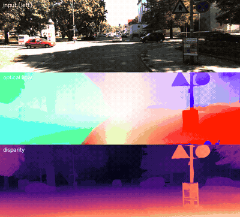
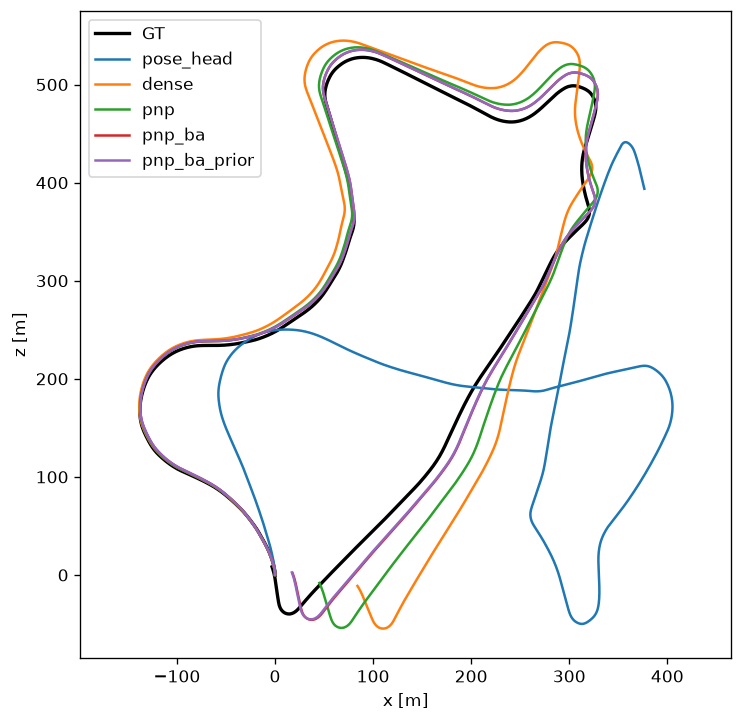
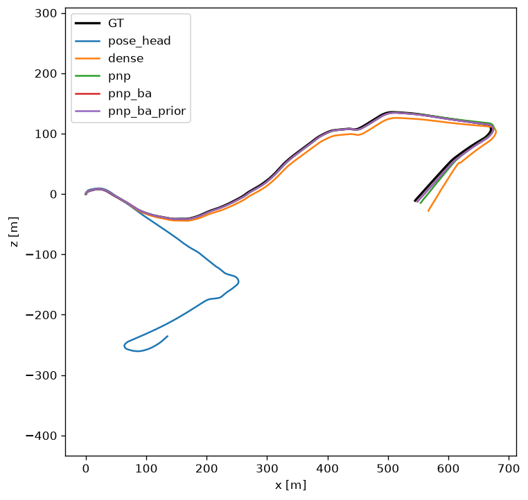
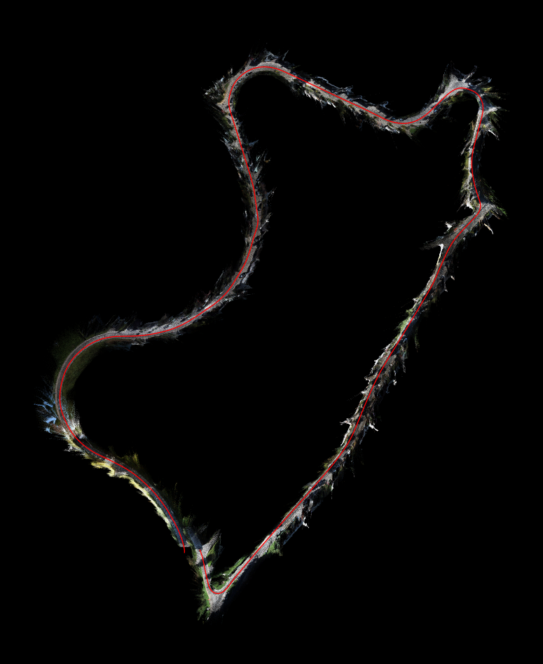

# StereoFlowFormer: Joint Flow, Stereo, Motion Masks and Ego-Motion for Stereo VO
### PyTorch · UniMatch · KITTI · Virtual KITTI 2



*KITTI odometry seq. 08. Top: left input. Middle: optical flow. Bottom: disparity.* ([mp4](demo.mp4))

StereoFlowFormer is a transformer network that takes **two stereo pairs** (left/right at time
*t* and *t+1*) and predicts dense optical flow, disparity for both frames, motion-instance masks
learned without labels, and ego-motion with uncertainty. Its outputs drive a stereo VO back-end
with flow-based tracking, PnP, bundle adjustment and point-cloud mapping. The released stage-2b
model halves the KITTI 2015 flow error of its UniMatch initialisation, and the full VO pipeline
reaches **1.50 % / 0.76 %** translation error on the held-out KITTI odometry sequences 09 / 10.

## TODO List
- [x] Flow and stereo branches equivalent to UniMatch, checked against the official forward pass
- [x] Geometry encoding (depth, rays, 3D scene flow) and context encoder for the heads
- [x] Mask2Former-style motion-mask head, trained on self-supervised rigid-flow pseudo-labels
- [x] Pose head with predicted uncertainty
- [x] Supervised training on Virtual KITTI 2, self-supervised adaptation to KITTI (stages 1a-2b)
- [x] Stereo VO: dense PnP, tracked landmarks, PnP-RANSAC, local and global BA, pose-head priors
- [x] Point-cloud / TSDF mapping with moving objects removed
- [x] Rerun live visualisation
- [ ] Fix the pose-head train/test resolution mismatch (trained on 320×960 crops, run on full frames)
- [ ] Far-range disparity bias (trajectories come out 0.5-1 % too long)
- [ ] Masks for static-but-movable objects (parked cars are background today)
- [ ] Loop closure

## Pipeline


```
 L_t, R_t ────┬──► flow branch (GMFlow, swin attn, ⅛ + ¼ scales, 6 refinements) ──► flow fw/bw
 L_t+1, R_t+1 ┴──► stereo branch (GMStereo, 1D cross attn, 3 refinements) ───────► disparity t, t+1
                         │ ¼-res estimates + features
                         ▼
                  geometry encoding (depth, rays, scene flow) + context encoder ──► 1/16 tokens
                         ├──► mask head (8 slots, 3 decoder layers) ──────────────► motion masks
                         └──► pose head (pose token, 4 encoder layers) ───────────► ego-motion + log-variance
                                              │
                                              ▼
                  stereo VO: dense PnP init ─► PnP-RANSAC on tracks ─► keyframes ─► local / global BA
```
| Module | File | What it does |
|---|---|---|
| Matching branches | `dvo/models/match_branch.py` | UniMatch-equivalent flow and stereo branches (vendored UniMatch in `dvo/models/unimatch/`) |
| Heads | `dvo/models/heads.py` | Context encoder, Mask2Former-lite mask head, pose transformer |
| Model | `dvo/models/model.py` | Wires the branches, the ¼-resolution geometry encoding and the heads |
| Geometry | `dvo/geometry/` | SE(3), warping, weighted Kabsch, dense robust PnP |
| Losses | `dvo/losses/` | Sequence L1, SSIM + L1 photometric with occlusion masks, smoothness, motion pseudo-labels with Hungarian-matched CE + Dice, pose Gaussian NLL and rigid-flow consistency |
| Data | `dvo/data/` | Virtual KITTI 2, KITTI odometry and KITTI 2015 loaders |
| VO back-end | `dvo/slam/vo.py`, `dvo/slam/ba.py` | Flow tracking with forward-backward and static-mask checks, PnP-RANSAC, stereo BA (Levenberg-Marquardt, Schur complement, Huber loss, optional pose-head priors) |
| Mapping | `dvo/slam/mapping.py` | Keyframe point clouds and TSDF fusion |

**Motion masks without labels:** ego-motion is estimated per batch by dense robust PnP between
the stereo 3D points of frame *t* and their flow correspondences. Pixels whose flow disagrees
with that rigid motion beyond an uncertainty-aware threshold are labelled moving, and connected
components become instances.

**Training stages:**

| stage | config | data | trained |
|---|---|---|---|
| 1a | `configs/stage1a_heads.yaml` | Virtual KITTI 2 | heads only, branches frozen |
| 1b | `configs/vkitti2_sup.yaml` | Virtual KITTI 2 | everything, supervised |
| 2 | `configs/kitti_selfsup.yaml` | KITTI odometry 00-08 | everything, self-supervised |
| **2b** | `configs/kitti_heads.yaml` | KITTI odometry 00-08 | heads only, on the 1b branches |

## Data Preparation
`scripts/download_data.py` downloads only what is needed (about 25 GB on disk): the Virtual KITTI 2
`clone` variant, KITTI odometry colour sequences 00-10 with ground-truth poses, and KITTI 2015
scene flow.
```Shell
.venv/bin/python scripts/download_data.py --root data
```
```Shell
├── data
    ├── vkitti2
        ├── Scene01
            ├── clone
                ├── frames
                    ├── rgb, depth, forwardFlow, backwardFlow, instanceSegmentation
                ├── intrinsic.txt, extrinsic.txt, pose.txt, bbox.txt
        ├── Scene02, Scene06, Scene18, Scene20
    ├── kitti_odometry
        ├── sequences
            ├── 00 ... 10
                ├── image_2, image_3, calib.txt, times.txt
    ├── kitti_odometry_poses
        ├── dataset/poses/00.txt ... 10.txt
    ├── kitti2015
        ├── training
            ├── image_2, image_3, flow_occ, disp_occ_0, disp_occ_1, obj_map, calib_cam_to_cam
```

## Requirements
Tested on Ubuntu with Python 3.12, PyTorch 2.11 (cu128) and an RTX 5090.
```shell
python3 -m venv .venv
.venv/bin/pip install torch torchvision --index-url https://download.pytorch.org/whl/cu128
.venv/bin/pip install -r requirements.txt
```

## Models
The branches start from the UniMatch Things / SceneFlow weights (no KITTI 2015 exposure):
```shell
mkdir -p checkpoints/unimatch && cd checkpoints/unimatch && \
  B=https://s3.eu-central-1.amazonaws.com/avg-projects/unimatch/pretrained && \
  curl -LO $B/gmflow-scale2-regrefine6-things-776ed612.pth && \
  curl -LO $B/gmstereo-scale2-regrefine3-resumeflowthings-sceneflow-f724fee6.pth && cd -
```
Train the stages in order. Each one writes `runs/<name>/checkpoints/latest.pth`:
```shell
.venv/bin/python scripts/train.py --config configs/stage1a_heads.yaml
.venv/bin/python scripts/train.py --config configs/vkitti2_sup.yaml
.venv/bin/python scripts/train.py --config configs/kitti_selfsup.yaml
.venv/bin/python scripts/train.py --config configs/kitti_heads.yaml
```
Override any config key with `--set train.iters=500 data.vkitti2_scenes=[Scene01]`.
```Shell
├── checkpoints
    ├── unimatch
        ├── gmflow-scale2-regrefine6-things-776ed612.pth
        ├── gmstereo-scale2-regrefine3-resumeflowthings-sceneflow-f724fee6.pth
├── runs
    ├── stage1a_heads
    ├── stage1b_vkitti2
    ├── stage2_kitti_selfsup
    ├── stage2b_kitti_heads
        ├── checkpoints/latest.pth          # released model
```
Speed: about 160 ms per forward pass of the full network (bidirectional flow, two stereo pairs
and heads) at 320×960 on an RTX 5090 in bf16.

## Evaluation
```Shell
CKPT=runs/stage2b_kitti_heads/checkpoints/latest.pth
.venv/bin/python scripts/eval.py --dataset kitti2015 --ckpt $CKPT
.venv/bin/python scripts/run_vo.py --seq 09 --ckpt $CKPT --modes pose_head dense pnp pnp_ba pnp_ba_prior --map
```

**KITTI 2015 training set** (200 frames, full resolution, not used for training). Moving IoU
compares the predicted non-background slots with the KITTI 2015 moving-object maps.

| model | Flow EPE | Fl-all | Disp EPE | D1-all | Moving IoU | Precision | Recall |
|---|---|---|---|---|---|---|---|
| UniMatch initialisation | 5.50 px | 17.4 % | 1.22 px | 5.70 % | – | – | – |
| Stage 1b: supervised, Virtual KITTI 2 | 2.47 px | 7.75 % | 0.95 px | 3.66 % | 0.33 | 0.49 | 0.48 |
| Stage 2: self-supervised KITTI, all weights | 2.92 px | 11.3 % | 1.51 px | 6.21 % | **0.45** | 0.58 | **0.67** |
| **Stage 2b: self-supervised KITTI, heads only** | **2.47 px** | **7.75 %** | **0.95 px** | **3.66 %** | 0.41 | **0.58** | 0.59 |

**KITTI odometry 09 (1.7 km) and 10 (0.9 km)**, held out (training used 00-08). Every back-end
runs on the same stage-2b network outputs. t_err (%) and r_err (°/100 m) follow the KITTI
protocol. ATE is the RMS position error after SE(3) alignment, with no scale correction.

| back-end | 09 t_err | 09 r_err | 09 ATE | 10 t_err | 10 r_err | 10 ATE |
|---|---|---|---|---|---|---|
| Pose head only | 34.0 % | 13.6 | 206.6 m | 51.5 % | 19.5 | 78.8 m |
| Dense robust PnP, frame to frame | 3.28 % | 1.02 | 25.9 m | 2.07 % | 1.32 | 6.89 m |
| + tracked landmarks, PnP-RANSAC | 2.36 % | 0.71 | 15.5 m | 1.33 % | 0.69 | 3.59 m |
| + local and global bundle adjustment | 1.51 % | 0.41 | 7.12 m | 0.79 % | 0.34 | 1.70 m |
| **+ pose-head priors in BA** | **1.50 %** | **0.41** | **6.92 m** | **0.76 %** | **0.31** | **1.66 m** |

<p>
  
  
</p>

*Top-down trajectories on sequences 09 (left) and 10 (right) for every back-end, against ground truth (black).*

Findings:
1. **Supervised fine-tuning on Virtual KITTI 2 halves the flow error** and cuts disparity
   outliers by a third.
2. **Fine-tuning the whole network photometrically on KITTI (stage 2) hurts matching.** It gives
   the best masks but makes flow and disparity worse. Stage 2b therefore freezes the 1b branches
   and adapts only the heads, which keeps the matching accuracy and most of the mask gain.
3. **Bundle adjustment gives the largest VO gain.** Compared with PnP alone it halves the ATE and
   cuts t_err by 35-40 %.
4. **The pose head alone drifts.** Its per-frame errors are small but biased (about +0.11° yaw
   and −0.08° pitch per frame), mostly because it was trained on 320×960 crops and runs on
   padded full frames. Its predicted uncertainty is well correlated with the actual error, so it
   still helps slightly as a prior inside BA.

Before fine-tuning, on Virtual KITTI 2 validation (320×960 crops, last 50 frames of each scene)
the UniMatch initialisation reaches 0.57 px flow EPE (Fl 2.8 %) and 0.70 px disparity EPE (D1 3.6 %).

## Visualization
Flow, disparity and masks for selected frames (written to `vis/`):
```Shell
.venv/bin/python scripts/visualize.py --seq 09 --frames 0 200 400 --ckpt $CKPT
```
Live view of the VO run in the [Rerun](https://rerun.io) viewer (camera, depth, masks, flow,
trajectory against ground truth and keyframe point clouds). `--save` writes an `.rrd` file instead:
```Shell
.venv/bin/python scripts/rerun_vis.py --seq 09 --max_frames 300
```
The point-cloud map from `run_vo.py --map` fuses keyframe stereo depth with moving objects removed:

<p align="center"></p>

The architecture figure is regenerated with `python docs/make_architecture.py docs/architecture.svg`.

## Tests
```Shell
.venv/bin/python -m pytest    # geometry, losses, model shapes, synthetic BA, UniMatch equivalence
```
The UniMatch equivalence test needs CUDA and the official repository in `third_party/unimatch`.

## License
No license has been chosen for this repository yet. The vendored UniMatch code in
`dvo/models/unimatch/` keeps its MIT license.

## Citation
StereoFlowFormer builds on these works:
```bibtex
@article{xu2023unimatch,
  title   = {Unifying Flow, Stereo and Depth Estimation},
  author  = {Xu, Haofei and Zhang, Jing and Cai, Jianfei and Rezatofighi, Hamid and Yu, Fisher and
             Tao, Dacheng and Geiger, Andreas},
  journal = {IEEE Transactions on Pattern Analysis and Machine Intelligence},
  year    = {2023}
}
@inproceedings{cheng2022mask2former,
  title     = {Masked-attention Mask Transformer for Universal Image Segmentation},
  author    = {Cheng, Bowen and Misra, Ishan and Schwing, Alexander G. and Kirillov, Alexander and
               Girdhar, Rohit},
  booktitle = {CVPR},
  year      = {2022}
}
@misc{cabon2020vkitti2,
  title  = {Virtual KITTI 2},
  author = {Cabon, Yohann and Murray, Naila and Humenberger, Martin},
  eprint = {2001.10773},
  archivePrefix = {arXiv},
  year   = {2020}
}
@inproceedings{geiger2012kitti,
  title     = {Are we ready for Autonomous Driving? The KITTI Vision Benchmark Suite},
  author    = {Geiger, Andreas and Lenz, Philip and Urtasun, Raquel},
  booktitle = {CVPR},
  year      = {2012}
}
@inproceedings{menze2015kitti2015,
  title     = {Object Scene Flow for Autonomous Vehicles},
  author    = {Menze, Moritz and Geiger, Andreas},
  booktitle = {CVPR},
  year      = {2015}
}
```
