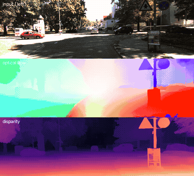

# StereoFlowFormer

A transformer network that takes **two stereo pairs** (left/right at time *t* and *t+1*) and predicts:

- **Optical flow** (L_t → L_t+1, forward and backward) from a global 4D correlation volume over transformer features, refined locally
- **Disparity / inverse depth** for both frames from 1D epipolar correlation
- **Motion-instance masks**, learned without labels: pixels whose flow is not explained by the camera's rigid motion become moving objects
- **Ego-motion** with uncertainty

These outputs feed a stereo VO back-end: flow-based tracking, PnP, sparse stereo bundle adjustment and RGB-D mapping.

*KITTI odometry seq. 08. Top: left input. Middle: optical flow. Bottom: disparity.* ([mp4](demo.mp4))

## Current numbers (pretrained baseline)

Flow and stereo branches as initialised from UniMatch, before any fine-tuning.

**KITTI 2015 training set** (200 frames, zero-shot, full resolution)

| Task | EPE | Outliers |
|---|---|---|
| Optical flow | 5.50 px | Fl-all 17.4 % |
| Disparity | 1.22 px | D1-all 5.70 % |

**Virtual KITTI 2 validation** (320×960 crops, last 50 frames of each scene)

| Task | EPE | Outliers |
|---|---|---|
| Optical flow | 0.57 px | Fl 2.8 % |
| Disparity | 0.70 px | D1 3.6 % |

Speed: about 160 ms per forward pass of the full network (bidirectional flow, two stereo pairs and heads) at 320×960 on an RTX 5090 in bf16.

## Status

Work in progress. The demo shows the flow and stereo branches, which are initialised from
[UniMatch](https://github.com/autonomousvision/unimatch) pretrained weights (Things / SceneFlow).
Training of the mask and pose heads on Virtual KITTI 2 and self-supervised KITTI fine-tuning are underway.
Code will be added once results are in.
